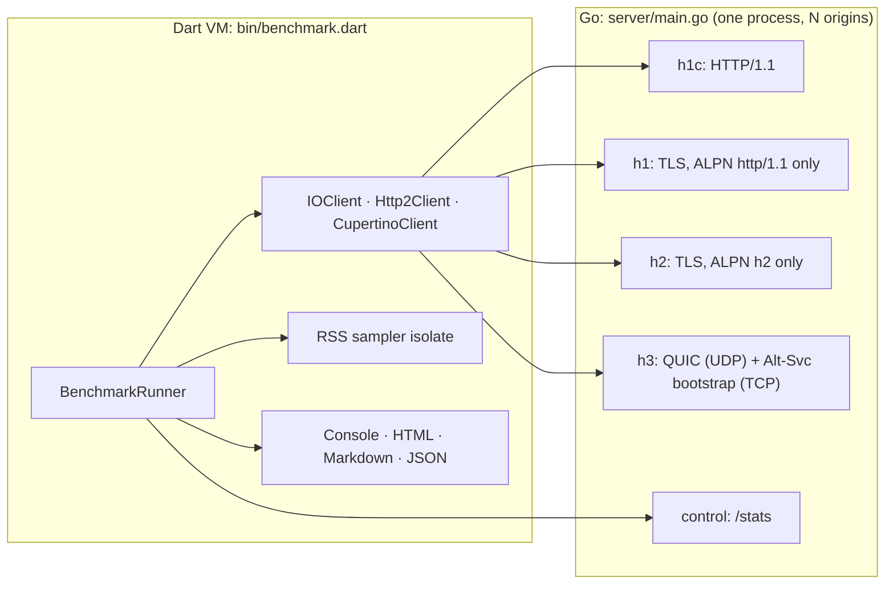

# http_client_benchmarks

[](https://github.com/brianquinlan/http_client_benchmarks/actions/workflows/ci.yaml)

Benchmarks that compare the performance of `package:http`
[`Client`](https://pub.dev/documentation/http/latest/http/Client-class.html)
implementations over HTTP/1.1, HTTP/2 and HTTP/3.

The benchmarks run in the Dart VM and exercise:

| Client | Package | Protocols |
| --- | --- | --- |
| `IOClient` | [`package:http`](https://pub.dev/packages/http) | HTTP/1.1 (cleartext and TLS) |
| `Http2Client` | [`package:http2`](https://pub.dev/packages/http2) | HTTP/2 |
| `CupertinoClient` (macOS only) | [`package:cupertino_http`](https://pub.dev/packages/cupertino_http) | HTTP/1.1 (cleartext and TLS), HTTP/2, HTTP/3 |

Requests are served by a purpose-built server, written in Go, that speaks
every protocol (using [`quic-go`](https://github.com/quic-go/quic-go) for
HTTP/3).

## Requirements

* Dart 3.10 or later.
* [Go](https://go.dev/dl/) 1.26 or later. The server is built automatically
  (with `go build`) whenever the benchmarks run; the first build downloads
  `quic-go`.
* macOS with the Xcode command line tools to benchmark `CupertinoClient`.

## Running the benchmarks

```shell
git clone https://github.com/brianquinlan/http_client_benchmarks.git
cd http_client_benchmarks
dart pub get

# A quick smoke test (fewer trials and smaller payloads), about 30 seconds.
dart run bin/benchmark.dart run --quick

# The full suite, which takes a few minutes.
dart run bin/benchmark.dart run
```

Results are printed as tables as each scenario completes, followed by an
overall ranking. Reports are written to `benchmark_results/<timestamp>/`:

* `report.html`: a self-contained page with charts. It has no external
  dependencies, so it can be attached to an issue or shared as a file.
  Unchecking a client hides it and recomputes the relative results without
  it (e.g. to compare only the TLS clients).
* `report.md`: Markdown tables, suitable for pull requests and GitHub Actions
  job summaries.
* `results.json`: the raw results, used by the `compare` command.

Useful options (see `dart run bin/benchmark.dart run --help` for all of them):

```shell
# Only some clients, protocols or scenarios ("*" is a wildcard).
dart run bin/benchmark.dart run --client cupertinoclient --protocol h2 --protocol h3
dart run bin/benchmark.dart run --scenario 'upload-*' --category downloads

# More trials for more precise results.
dart run bin/benchmark.dart run --trials 15 --warmup 3

# Measure the overhead of the HTTP profiling used by the DevTools network view.
dart run bin/benchmark.dart run --quick --http-profiling

# List the scenarios and clients.
dart run bin/benchmark.dart list
```

### Benchmarking `CupertinoClient` over TLS, HTTP/2 and HTTP/3

`IOClient` and `Http2Client` are configured to trust the benchmark server's
certificate authority (CA), but `CupertinoClient` uses the macOS trust store.
Until the CA is trusted, `CupertinoClient` can only be benchmarked over
cleartext HTTP/1.1, and the benchmark explains how to trust the CA:

```shell
security add-trusted-cert -r trustRoot -p ssl \
  -k ~/Library/Keychains/login.keychain-db \
  .dart_tool/http_client_benchmarks/certs/ca.pem
```

The CA is created on the first run and reused afterwards. It uses X.509 name
constraints and is restricted to TLS server authentication, so it can only
issue server certificates for `localhost`, `127.0.0.0/8` and `::1`; even if
its private key were leaked it could not be used to impersonate other servers
(and `-p ssl` only trusts it for TLS). To stop trusting it:

```shell
security remove-trusted-cert .dart_tool/http_client_benchmarks/certs/ca.pem
```

### Benchmarking unreleased client changes

The clients come from pub.dev, at the versions recorded in `pubspec.lock`;
run `dart pub upgrade` to benchmark their latest releases.

To benchmark local changes to a client, or to a package that it depends on,
point the benchmarks at your checkout with a `pubspec_overrides.yaml` file
(which git ignores), for example:

```yaml
dependency_overrides:
  cupertino_http:
    path: ../http/pkgs/cupertino_http
  objective_c:
    path: ../native/pkgs/objective_c
```

Then run `dart pub get`. If a checkout needs an unreleased version of another
package (for example `package:http`), override that package too. To go back to
the published versions, delete the file and run `dart pub get` again.

To measure the effect of a change, save the `results.json` of runs without and
with the override and [compare them](#comparing-runs). Differences of 5–20%
between identical runs are common, so run the two versions back to back, and
more than once.

## How it works



* **Protocol selection.** Each protocol is served on its own port with only
  that protocol offered during ALPN, so clients that negotiate automatically
  (like `NSURLSession`) can be steered towards a particular protocol. HTTP/3 is
  discovered through an `Alt-Svc` header sent by a TCP listener that shares
  the HTTP/3 port number; that listener closes each connection after one
  response, so clients quickly switch to QUIC.
* **Protocol verification.** Every response carries an `X-Protocol` header with
  the protocol the server saw. Before running scenarios, each client variant
  is checked (and HTTP/3 primed); a variant that cannot reach the server with
  its protocol is reported as unavailable rather than measured, and a run
  fails if its fresh client cannot be primed. Runs in which more than 1% of
  requests used an unexpected protocol are flagged with `!` and left out of
  the summary scores.
* **Trials.** Each scenario runs with a fresh client: a few warmup trials
  (which also warm the JIT and the connection pool) and then several measured
  trials. The order of the clients rotates from one scenario to the next so
  that no client always runs first. A failure or timeout only affects one
  scenario/client pair: the runner stops a failed run from starting new
  requests, then waits (for a limited time) for its outstanding requests to
  finish and its connections to close before starting the next run.
* **Server-side counters.** The server counts the distinct connections that
  served requests during each trial (the "Conns" column), and how many body
  bytes it has sent or received for individual requests. The latter shows
  whether a client buffers data: for example, how much of a response the
  server could send while the app was not reading it.
* **Memory.** A helper isolate samples the process's resident set size every
  5 ms, so the peak growth during a trial is captured even while the main
  isolate is busy (but not during garbage collection pauses, which stop all
  isolates).

## Scenarios

| Category | Scenario | Measures |
| --- | --- | --- |
| Concurrency | `get-sequential` | Per-request overhead (median latency of sequential 1 KiB GETs). |
| | `get-concurrent-16`, `get-concurrent-128` | Requests/s with 16 or 128 requests in flight: connection pooling vs. multiplexing. |
| | `get-delayed-concurrent-100` | Requests/s when each response takes 20 ms; exposes per-host connection limits. |
| | `get-multi-origin-64` | Requests/s with requests spread across 4 origins. |
| | `head-of-line` | Latency of a burst of small requests sent while 6 slow requests are outstanding: do small requests queue behind them? |
| Downloads | `download-1mib-sequential`, `download-large`, `download-concurrent` | Download throughput (sequential, single large, concurrent). |
| | `download-small-writes` | Download throughput when the server writes the response 16 KiB at a time, as streaming servers and proxies often do (exposes per-frame and per-read overhead). |
| | `server-sent-events` | Delay between the server writing an event and Dart receiving it (e.g. LLM token streaming). |
| | `download-slow-consumer` | Backpressure: how much of a response the server could send (measured by the server) while the app had paused the response stream. Up to about 8 MiB fits in the operating system's socket buffers and flow-control windows, so smaller values are treated as equal. |
| | `download-cancel` | Time from cancelling a response stream part way through until the next request completes (plus, in the notes, the `cancel()` time and the bytes sent but never read). |
| Uploads | `upload-1mib-sequential`, `upload-large-buffered`, `upload-concurrent` | Upload throughput from memory (`Request.bodyBytes`). |
| | `upload-large-streamed`, `upload-streamed-small-chunks` | Streaming upload throughput (64 KiB and 1 KiB chunks, produced on demand). The notes show how far the client read ahead of the server, which reveals whether it buffers the whole body. |
| | `multipart-upload` | Latency of `MultipartRequest` uploads with form fields and a file. |
| Connections | `cold-client` | Latency of a request made with a brand new client (client setup plus TCP/TLS/QUIC handshakes). |
| Payloads | `many-headers` | Latency with 50 request and 50 response headers (HPACK/QPACK, header marshalling). |
| | `json-burst` | Time to fetch and decode 32 JSON documents concurrently. |
| | `gzip-download` | Throughput of gzip-compressed responses, including decompression. |

The requests/s scenarios keep sending requests for at least 500 ms per trial
(100 ms with `--quick`) so that fast clients are measured for long enough.
`--quick` keeps the same scenarios but uses fewer requests and smaller
payloads, so its results should not be compared with full runs.

## Reading the results

| Column | Meaning |
| --- | --- |
| Primary metric (▲ higher is better, ▼ lower is better) | The median, across trials, of the scenario's primary metric, ± the median absolute deviation as a percentage. |
| p50 / p99 | Percentiles of all samples (usually per-request latency) across all trials. |
| TTFB | Time until the response headers were received. |
| Conns | The number of distinct connections that served requests during a trial (counted by the server). |
| Peak RSS | The largest growth of the process's resident set size during a trial (the median across trials). A rough guide only; see the caveats below. |
| Relative | Performance relative to the best client in the scenario (1.00× is best). |

The summary ranks clients by the geometric mean of their relative performance
across scenarios. So that the scores are comparable, they only cover the
scenarios that every client completed using its expected protocol (failures
are listed separately), and scenarios that measure memory use are not
included. The cleartext (`h1c`) variants have no TLS overhead, so they are best
treated as a baseline; compare clients that use the same protocol.

To regenerate `report.html` and `report.md` from a `results.json` file (for
example, after updating the benchmarks), run:

```shell
dart run bin/benchmark.dart report benchmark_results/<timestamp>/results.json
```

## Comparing runs

To check whether a change improves performance, save the `results.json` of a
run before and after the change and compare them:

```shell
dart run bin/benchmark.dart compare before/results.json after/results.json
```

A change is only reported when a two-sided Mann-Whitney U test on the
per-trial values finds it significant (p < 0.05 by default, see `--alpha`) and
it is at least 5% (see `--threshold`). Results marked `?` had too few trials
for any change to be significant: the default 7 trials are plenty, but runs
with 3 trials (such as `--quick` runs) can never show a significant change.
When comparing many scenarios, a few changes will appear significant by
chance; `--fdr` adjusts the p-values for the number of comparisons
(Benjamini-Hochberg). The command warns about differences between the runs,
such as different machines or software versions, and skips scenarios whose
definitions changed. `--markdown` also writes the comparison as Markdown.

## Methodology and caveats

* **Loopback only.** The client and server run on the same machine and talk
  over the loopback interface, so there is no network latency or packet loss.
  This isolates client overhead but hides the situations in which HTTP/2 and
  HTTP/3 differ most (e.g. head-of-line blocking under packet loss).
* **Shared CPU.** The server competes with the client for CPU. To see the most
  that the server can deliver with Go's own clients on your machine, run
  `go test -bench=. -run='^$'` in the `server` directory. On an Apple M5 Pro the
  server sustained roughly 2.6 GB/s for HTTP/1.1 over TLS and 1.2 GB/s for
  HTTP/2, but only about 200–260 MB/s for HTTP/3, because `quic-go` sends one
  1,452 byte packet per system call on macOS. **HTTP/3 bulk transfer results
  are therefore limited by the server**; HTTP/3 latency and concurrency
  results are not.
* **JIT.** `dart run` uses the JIT compiler; the warmup trials let it
  optimize the hot code before measurements start. They also fill the
  server's caches (e.g. the compressed `/text` bodies), so use at least one
  warmup trial when comparing clients.
* **Sequential trials.** Each client's trials run back to back, and clients
  run one after another, so slow drift in the machine's state (e.g. thermal
  throttling or background activity) can favor some clients. Rotating the
  order of the clients spreads this out, and `compare` helps to tell real
  changes from noise, but for important comparisons run the benchmarks more
  than once.
* **One process.** All clients run, one after another, in the same process,
  so memory measurements include everything in the process and are
  indicative rather than exact. In particular, memory freed by earlier trials
  (including warmup trials) may still be resident, because neither the Dart VM
  nor `malloc` return all freed memory to the operating system immediately,
  so later trials can understate how much memory a client needs. This is why
  buffering is measured by the server (`download-slow-consumer` and the
  read-ahead notes of the streamed uploads) rather than through memory use;
  treat the "Peak RSS" column as a rough guide.
* **Default configurations.** Clients are benchmarked with their default
  settings, as most applications use them. Notably, `NSURLSession` (used by
  `CupertinoClient`) opens at most 6 connections per host by default
  (`HTTPMaximumConnectionsPerHost`), `HttpClient` (used by `IOClient`) has no
  limit, and `Http2Client` multiplexes up to 100 concurrent requests on each
  connection before opening another. The `Conns` column shows the effect.
* **Server differences between protocols.** Some differences between
  protocols come from the server rather than the client. For example,
  `quic-go` does not use QPACK's dynamic table, so `many-headers` sends every
  header in full over HTTP/3 but compresses repeated headers over HTTP/2.
* **Closed-loop load.** Concurrency scenarios keep a fixed number of requests
  in flight rather than issuing requests at a fixed rate, so a client that
  stalls simply issues fewer requests (the latency percentiles do not include
  the time that requests would have spent waiting to be issued).
* **HTTP profiling.** `--http-profiling` makes clients record request and
  response bodies (as the DevTools network view does), which uses a lot of
  memory for large transfers; combine it with `--quick`. `Http2Client` does
  not support HTTP profiling, so it does the same work either way; compare
  each client with and without profiling rather than clients with each other.
* **Proxies.** Proxies configured through environment variables (e.g.
  `http_proxy`) are ignored by the `dart:io` clients so that requests always
  go directly to the benchmark server. `CupertinoClient` uses the system proxy
  settings, which normally bypass loopback addresses; if you use a system-wide
  proxy, make sure that it is not used for `127.0.0.1`.

## Extending the benchmarks

* **Clients:** add a `ClientVariant` to `createClientVariants` in
  [`lib/src/clients.dart`](lib/src/clients.dart).
* **Scenarios:** subclass `Scenario` (see
  [`lib/src/scenarios.dart`](lib/src/scenarios.dart)) and add it to
  `createScenarios`. Use `timedSend` to record latency and time to first byte,
  and `runConcurrently` to keep a fixed number of requests in flight.
* **Server endpoints:** see the documentation at the top of
  [`server/main.go`](server/main.go); run the server's tests with `go test` in
  the `server` directory.

See [CONTRIBUTING.md](CONTRIBUTING.md) for how to test and send changes.

## License

BSD 3-Clause; see [LICENSE](LICENSE).
